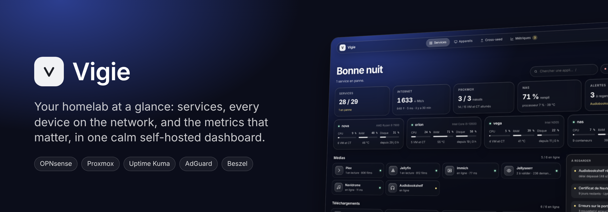
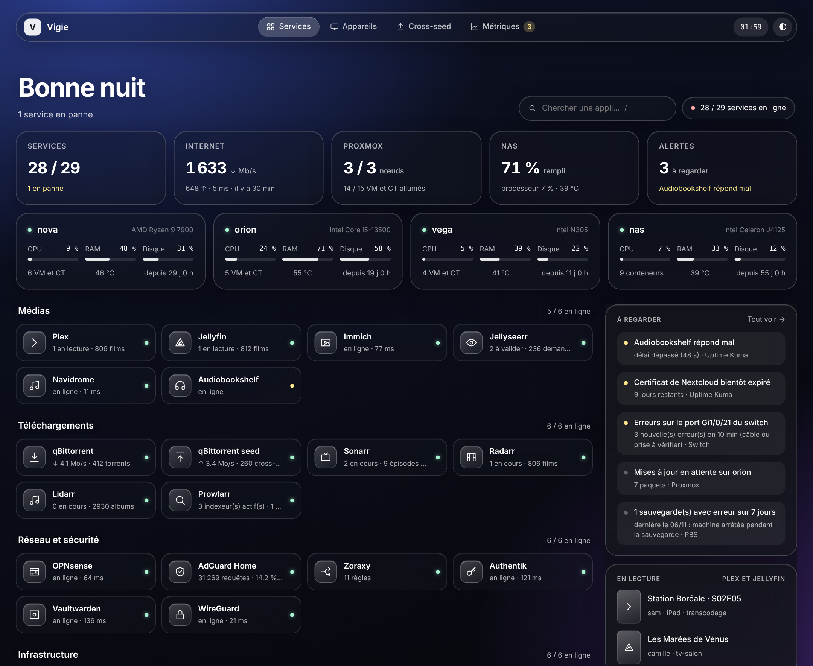
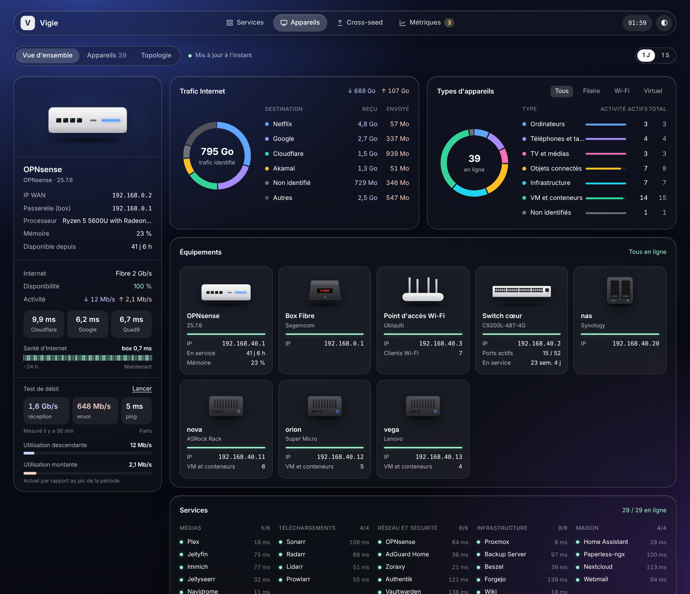
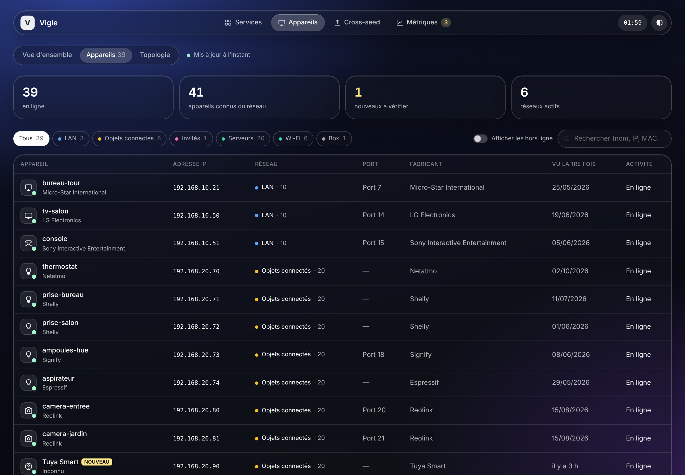
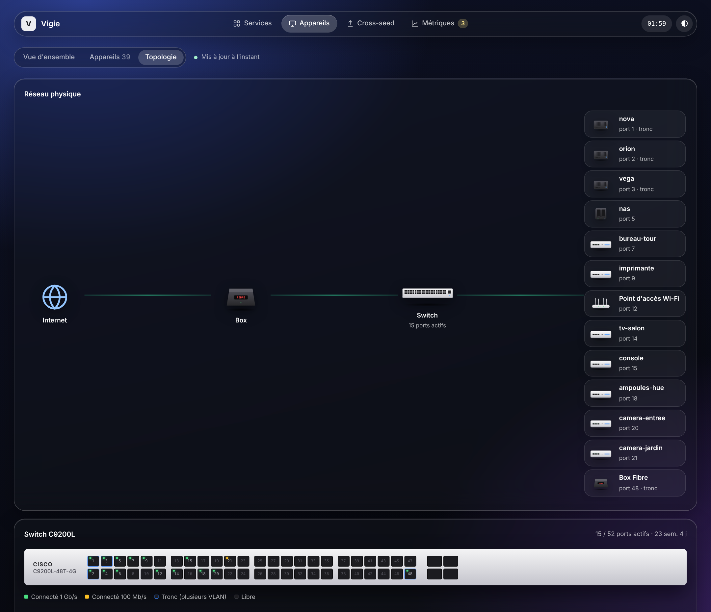
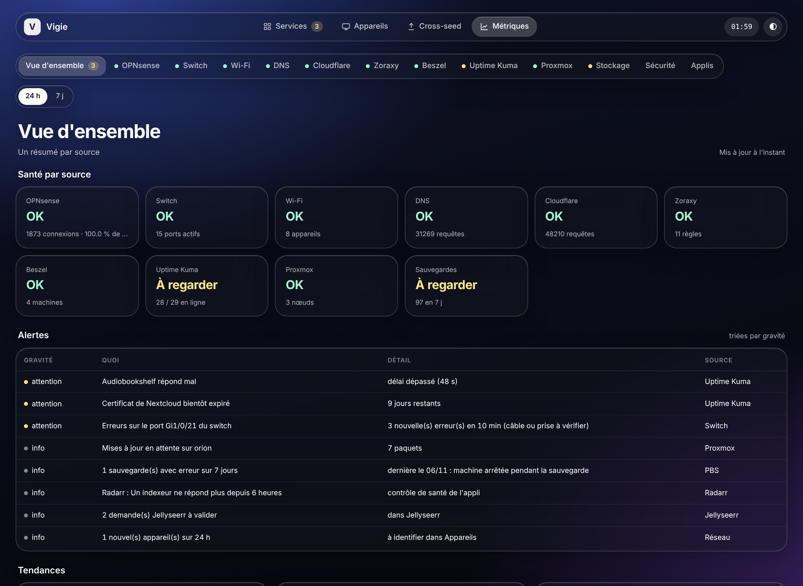
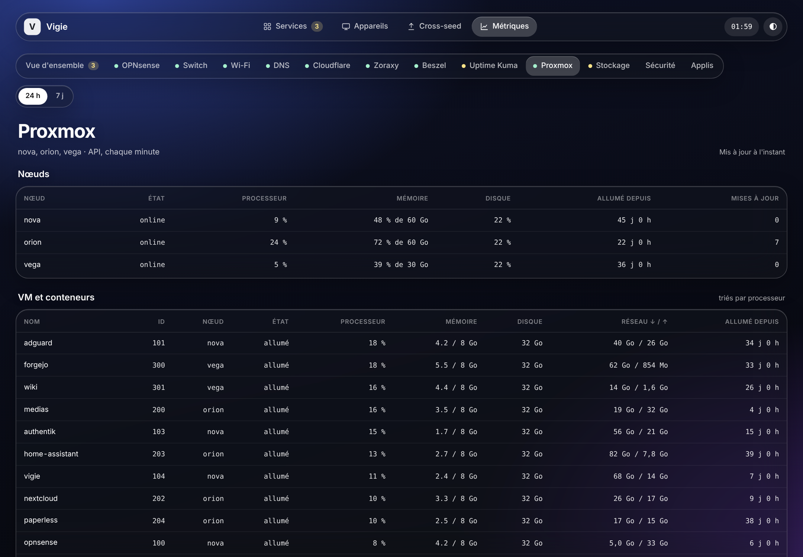
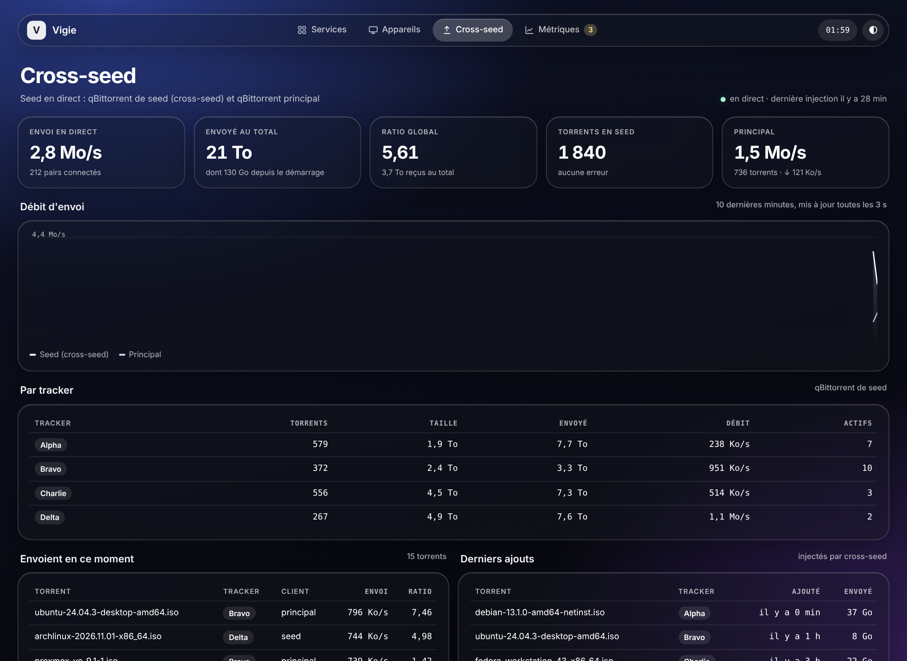
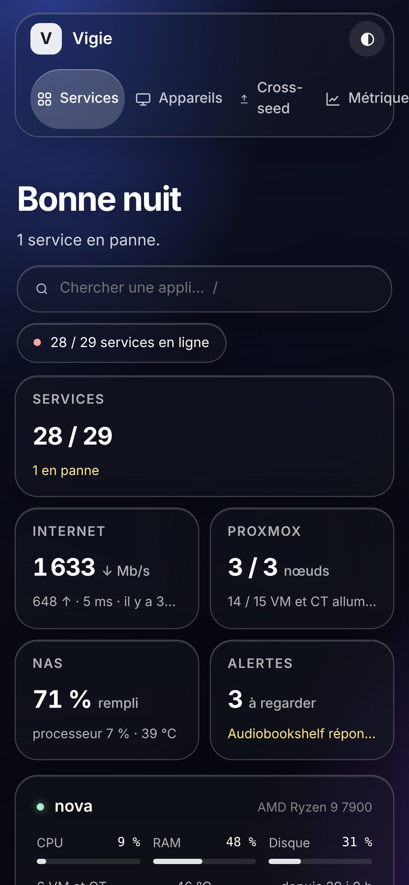

<p align="center">
  
</p>

<p align="center">
  <a href="LICENSE"></a>
  
  
  
  
</p>

<p align="center"></p>

**Vigie** (French for *lookout*, the sailor who watches from the top of the mast) is a self-hosted dashboard for your homelab. Three pages:

- **Services** — every app you run, grouped, with live status and a useful number on each tile; your servers with CPU, RAM, disk and temperature; what needs your attention.
- **Devices** — everything plugged into your network, *UniFi-clients style*: name, maker, IP, network, switch port, first and last seen, with an e-mail when an unknown device shows up. Plus internet traffic by destination, latency, speed tests, firewall blocks, DNS and a physical topology of your switch and Proxmox hosts.
- **Metrics** — one tab per source (OPNsense, switch, Wi-Fi, DNS, Cloudflare, reverse proxy, Beszel, Uptime Kuma, Proxmox, storage, security, media apps) with tables and charts over 24 hours or 7 days.

Every integration is **optional**: Vigie only shows the cards and tabs of what you plug in. With nothing configured, it still scans your local network, measures latency and runs speed tests.

> The interface is currently in **French**. An English translation is welcome — see [Contributing](#contributing).

<p align="center">
  
</p>

## Features

- **Device inventory** from the OPNsense ARP table and DHCP leases, a ping sweep of each network, the local ARP table, your Cisco switch's MAC table (which port each device is on) and Proxmox (VM and container names from their MAC address). Name, type, notes and "known" flag are editable from the page; history of connections and IP changes.
- **New device alerts** by e-mail.
- **Internet overview**: throughput from the OPNsense interface counters, usage per device and per destination (Netflix, Google, Steam…), latency to several targets and to your ISP router, availability over time, multi-stream speed test to Cloudflare every 6 hours or on demand.
- **Firewall**: ports probed from the internet, insistent addresses, devices blocked between your VLANs.
- **Topology**: Internet → router → switch → what is plugged in, a live switch front panel (speed, VLAN, trunk, errors) and Proxmox hosts with their guests.
- **Services page**: your apps in groups, status from Uptime Kuma or from the integration itself, a search box (`/`), servers at a glance, now playing on Plex and Jellyfin, backups.
- **Alerts**, sorted by severity: monitors down, hot or full disks, certificates about to expire, failed or old backups, switch port errors, pending updates, health checks of the *arr apps, failed sign-ins on your SSO, new devices.
- **Cross-seed page** (optional): two qBittorrent clients live, upload per tracker, latest injections.
- **Light**: Python standard library plus PyYAML, one SQLite file, no build step, no external request from the browser.
- **Dark glass interface**, 19 backgrounds to choose from, works on a phone.

| Source | What Vigie reads | Settings |
|---|---|---|
| OPNsense | ARP, DHCP leases, interface counters, top talkers, firewall log, system | `OPNSENSE_*` |
| Cisco IOS switch | MAC table, port status, VLANs, error counters (SSH, show commands only) | `CISCO_*` |
| Proxmox VE | nodes, VMs, containers, storage, pending updates, guest MAC addresses | `PROXMOX_*` |
| Proxmox Backup Server | datastore usage, last backup per guest, failed tasks | `PBS_*` |
| AdGuard Home | queries, blocked domains, top clients, upstreams | `ADGUARD_*` |
| Uptime Kuma | a public status page, certificate expiry | `KUMA_*` |
| Beszel | CPU, RAM, disks, temperatures, Docker containers | `BESZEL_*` |
| Zoraxy | reverse proxy rules | `ZORAXY_*` |
| Cloudflare | zone traffic, cache, threats, countries | `CLOUDFLARE_*` |
| Authentik | successful and failed sign-ins | `AUTHENTIK_*` |
| Plex, Jellyfin, Jellyseerr | now playing, libraries, requests | `PLEX_*`, `JELLYFIN_*`, `JELLYSEERR_*` |
| Sonarr, Radarr, Lidarr, Prowlarr | queue, upcoming, library size, indexers, health | `SONARR_*`… |
| qBittorrent | speeds, torrents, cross-seed | `config.yaml` |

All access is **read-only**. Use dedicated read-only accounts and tokens.

## Screenshots

<table>
  <tr>
    <td width="50%"><br><sub><b>Network</b> — router, internet health, speed test, traffic by destination, device types, equipment.</sub></td>
    <td width="50%"><br><sub><b>Devices</b> — every device, its network, port and maker; click one to name it.</sub></td>
  </tr>
  <tr>
    <td width="50%"><br><sub><b>Topology</b> — what is plugged where, switch front panel, Proxmox hosts.</sub></td>
    <td width="50%"><br><sub><b>Metrics</b> — health per source and every alert, sorted by severity.</sub></td>
  </tr>
  <tr>
    <td width="50%"><br><sub><b>Proxmox</b> — nodes, guests sorted by CPU, charts over 24 h or 7 days.</sub></td>
    <td width="50%"><br><sub><b>Cross-seed</b> — two qBittorrent clients, live, upload per tracker.</sub></td>
  </tr>
</table>

<p align="center"></p>

All screenshots use the built-in **demo mode**: every name, address and number is made up.

## Installation

Two ways: **Docker** or a **Proxmox LXC / Debian** machine. Vigie needs to sit on your LAN (host network): the ping sweep and the local ARP table must see your real network.

### Docker

```bash
git clone https://github.com/jean-pgt/vigie.git && cd vigie
cp .env.example .env                                  # fill in the integrations you use
mkdir -p config && cp config.example.yaml config/config.yaml   # describe your networks and apps
docker compose up -d --build
```

Vigie listens on port `8080` (`PORT` in `.env`). Data (one SQLite file) is stored in the `vigie-data` volume.

Just want to look around? Put `DEMO=1` in `.env`: Vigie fills a fresh database with fictional data and contacts nothing.

### Proxmox LXC or Debian

Create a Debian 12 or 13 container (1 core, 512 MB RAM and 2 GB disk are enough), on the network you want to watch, then inside the container:

```bash
apt-get update && apt-get install -y git
git clone https://github.com/jean-pgt/vigie.git /root/vigie && cd /root/vigie
bash install/lxc.sh
```

The script installs Python and the few tools Vigie uses (`fping`, `sshpass`), creates a `vigie` systemd service (unprivileged user with only the raw-socket capability for `fping`, hardened unit, starts on boot) and prints the URL.
Code lives in `/opt/vigie`, data in `/var/lib/vigie`, settings in `/etc/vigie/config.yaml` and `/etc/vigie/vigie.env`.

Update: `git pull && bash install/lxc.sh` — data and settings are kept.

> Give the container a **fixed IP address** (or a DHCP reservation): your reverse proxy points to it, and qBittorrent or AdGuard may need to allow it.

## Configuration

- **`.env`** — addresses and credentials of the integrations ([`.env.example`](.env.example)). Leave a block empty to turn it off.
- **`config.yaml`** — the structure of your homelab ([`config.example.yaml`](config.example.yaml)): title, networks (name, range, VLAN, colour, Wi-Fi or not), latency targets, switch trunk ports, apps of the Services page and their groups, servers to show, qBittorrent clients.

Restart after a change (`docker compose restart` or `systemctl restart vigie`).

## Authentication

Vigie has no login page: put it behind a reverse proxy that authenticates (Authentik, Authelia, oauth2-proxy, Zoraxy with SSO…). The proxy forwards the user's groups in a header; editing a device and starting a speed test are reserved to one group:

```yaml
sso:
  name: Authentik                  # shown in the Security tab
  groups_header: X-Authentik-Groups
  groups_separator: "|"
  admin_group: admins
```

With an empty `admin_group`, anyone who can reach Vigie can edit. Never expose it to the internet without a proxy in front.

## How it works

```
 OPNsense ─┐                                    ┌─ Services page
 switch ───┤   every minute     ┌──────────┐    ├─ Devices page
 Proxmox ──┼──────────────────▶ │  Vigie   │ ───┼─ Metrics page
 Kuma, …  ─┤  (read-only APIs)  │  SQLite  │    └─ /api/*.json
 ping, ARP ┘                    └──────────┘
```

One Python process: background threads read each source (every 2 minutes for devices, every minute for measurements, every 10 minutes for the switch and the ping sweep) and keep 8 days of time series and 35 days of hourly usage in SQLite. Pages are plain HTML and JavaScript, no build step. JSON endpoints: `/api/services`, `/api/appareils`, `/api/vue`, `/api/topologie`, `/api/metriques`, `/healthz`.

## Development

```bash
cd app && DEMO=1 DATA=/tmp/vigie-demo PORT=8080 python3 app.py   # fictional data, http://localhost:8080
python3 scripts/screenshots.py                                    # README screenshots (Playwright + Chromium)
```

## Contributing

Issues and pull requests are welcome: an English translation of the interface, new integrations (UniFi, pfSense, MikroTik, Pi-hole, TrueNAS…), other switch brands.

## License

[MIT](LICENSE)
